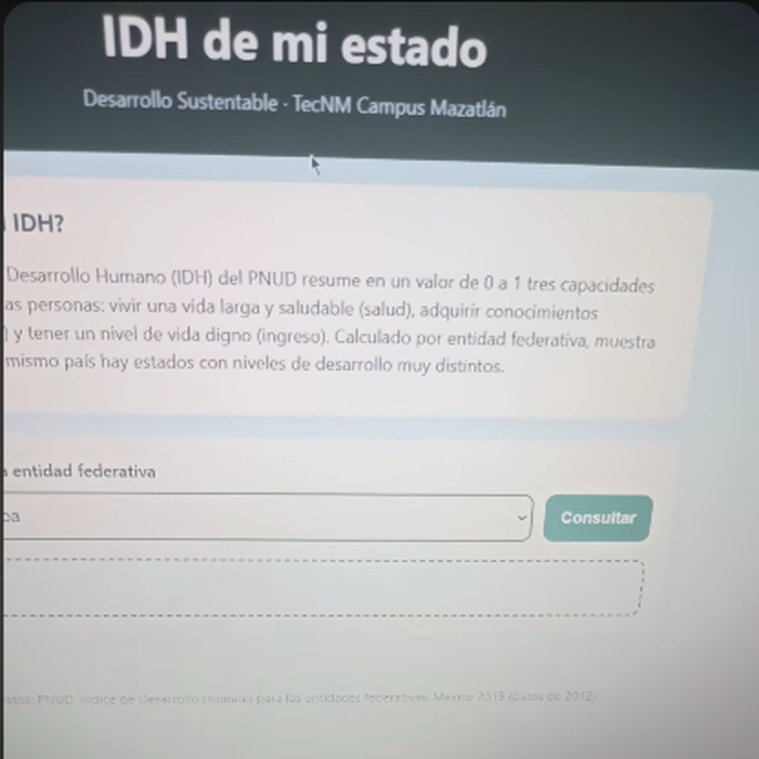
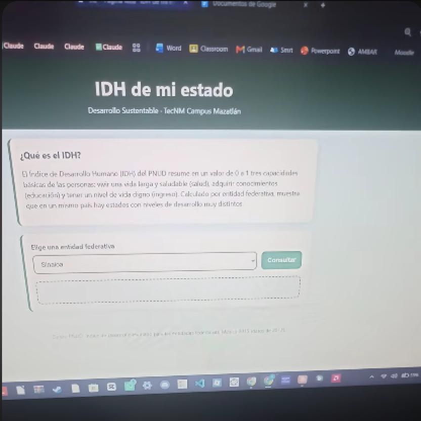
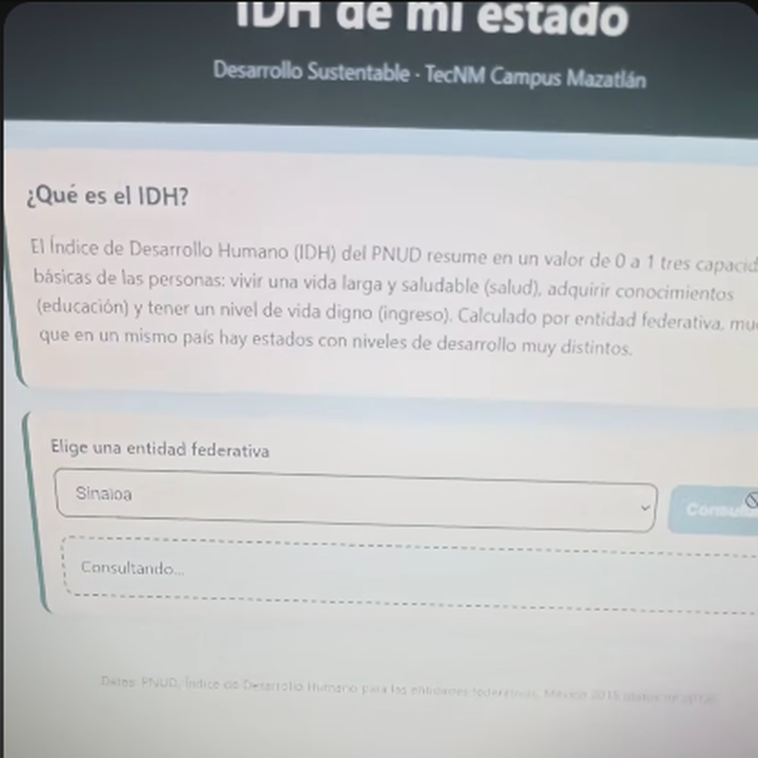
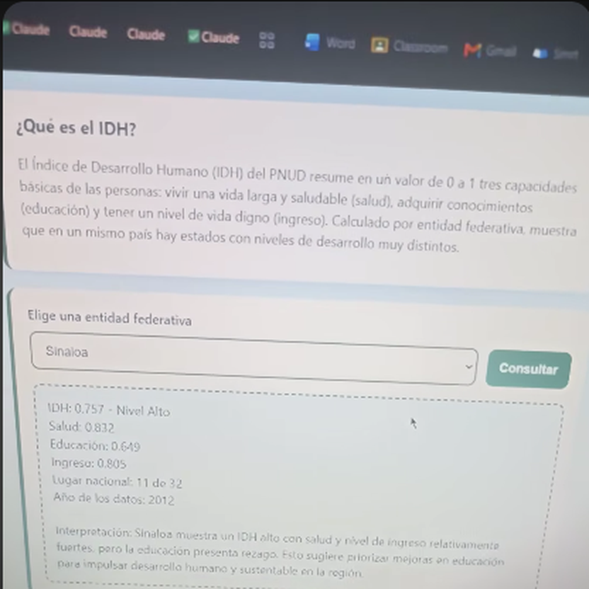

# Práctica 3.2 – Página web "IDH de mi estado"

| Campo | Detalle |
|---|---|
| Asignatura | Desarrollo Sustentable (ACD-0908) |
| Carrera | Ingeniería en Sistemas Computacionales |
| Institución | Tecnológico Nacional de México – Campus Mazatlán |
| Unidad / Tema | 3. Escenario socio-cultural / 3.2 Cultura, diversidad socio-cultural |
| Integrante | Cesar Jesus Gamez Mendoza (individual) |
| Video explicativo | [https://youtube.com/shorts/zsCoSbPDxxs](https://youtube.com/shorts/zsCoSbPDxxs) |
| Herramientas | IA generativa, Make (Custom webhook, Make AI Agent, Webhook response), GitHub Pages |
| Página publicada | [https://cesargm-max.github.io/IDH-de-mi-estado/](https://cesargm-max.github.io/IDH-de-mi-estado/) |

## Introducción

El Índice de Desarrollo Humano (IDH) del PNUD resume en un valor de 0 a 1 tres capacidades básicas: vivir una vida larga y saludable (salud), adquirir conocimientos (educación) y tener un nivel de vida digno (ingreso). El PNUD lo calcula como la media geométrica de los tres índices: IDH = IS^(1/3) × IE^(1/3) × II^(1/3). En esta práctica se construyó una página web donde se elige una entidad federativa y una IA responde con sus datos de IDH, usando únicamente un archivo de conocimiento tomado del informe *Índice de Desarrollo Humano para las entidades federativas, México 2015* (PNUD, datos de 2012).

## Actividad 1. Investigación de conceptos

1. **Desarrollo humano.** Proceso de ampliación de las opciones y capacidades de las personas para llevar la vida que valoran: salud, educación, ingreso y libertades. Se centra en las personas y no solo en el crecimiento económico.
2. **IDH y sus tres componentes.** Índice de Salud (esperanza de vida al nacer), Índice de Educación (años promedio y años esperados de escolarización) e Índice de Ingreso (ingreso nacional bruto per cápita en dólares PPC). Cada uno va de 0 a 1 y el IDH es su media geométrica, por lo que un rezago grave en una dimensión baja el resultado final.
3. **Índice de desarrollo social / rezago social (CONEVAL).** Resume carencias de la población en educación, salud, servicios básicos, calidad y espacios de la vivienda y activos del hogar, y clasifica a las entidades, municipios y localidades en grados de rezago (de muy bajo a muy alto). Mide carencias sociales, mientras que el IDH mide logros promedio.
4. **Diferencia entre desarrollo urbano y rural.** Las zonas urbanas concentran servicios, empleo formal e infraestructura; las rurales suelen tener población dispersa, menor acceso a servicios de salud y educación, y mayor dependencia de actividades primarias, con ingresos menores. Un promedio estatal mezcla ambas realidades.

## Actividades 2 a 7. Construcción técnica

| Actividad | Qué se hizo |
|---|---|
| 2. Knowledge | Se tomó la información de los Cuadros 2 y 3 del informe del PNUD (IDH, posición nacional, índices de salud, educación e ingreso, año 2012) para las 32 entidades y se guardó solo esa información en `IDH_entidades.pdf` (2 páginas, 5.78 KB) para no gastar créditos con el informe completo. |
| 3. Webhook | En Make se creó el escenario `IDH_Estado_Equipo1` con un **Custom webhook**. |
| 4. Página con IA | Se generó `index.html` (un solo archivo con CSS y JS) con lista de 32 entidades en orden alfabético, botón "Consultar", envío por `fetch` con `POST` y `URLSearchParams` con un único campo `entidad`, texto "Consultando...", respuesta en texto plano con `white-space: pre-line`, mensaje de error y diseño responsive en tonos verdes. |
| 5. Estructura de datos | Con **Run once** activo, se envió una consulta de prueba y el webhook detectó el campo `entidad`. |
| 6. Make AI Agent | Conexión *Make's AI Provider*, Knowledge con `IDH_entidades.pdf`, Input `Entidad: {{1.entidad}}` e instrucciones que obligan a responder solo con los datos del archivo, en texto plano y con formato fijo. |
| 7. Respuesta | **Webhook response** con status 200, cuerpo = respuesta del agente y headers `Content-Type: text/plain; charset=utf-8` y `Access-Control-Allow-Origin: *`. El escenario se guardó y se activó con **Immediately as data arrives**. |

## Actividad 8. Verificación contra la fuente

Se consultó la página con tres entidades: **Sinaloa**, la de mayor IDH (**Distrito Federal**, hoy Ciudad de México) y la de menor IDH (**Chiapas**). Cada cifra de la IA se comparó con las tablas del informe del PNUD.

| Entidad | Dato | Valor según la IA | Valor en el PDF | ¿Coincide? |
|---|---|---|---|---|
| Sinaloa | IDH | 0.757 (Alto) | 0.757 | Sí |
| Sinaloa | Salud | 0.832 | 0.832 | Sí |
| Sinaloa | Educación | 0.649 | 0.649 | Sí |
| Sinaloa | Ingreso | 0.805 | 0.805 | Sí |
| Sinaloa | Lugar nacional | 11 de 32 | 11 | Sí |
| Distrito Federal | IDH | 0.830 (Muy alto) | 0.830 | Sí |
| Distrito Federal | Salud | 0.857 | 0.857 | Sí |
| Distrito Federal | Educación | 0.783 | 0.783 | Sí |
| Distrito Federal | Ingreso | 0.852 | 0.852 | Sí |
| Distrito Federal | Lugar nacional | 1 de 32 | 1 | Sí |
| Chiapas | IDH | 0.667 (Bajo) | 0.667 | Sí |
| Chiapas | Salud | 0.805 | 0.805 | Sí |
| Chiapas | Educación | 0.528 | 0.528 | Sí |
| Chiapas | Ingreso | 0.700 | 0.700 | Sí |
| Chiapas | Lugar nacional | 32 de 32 | 32 | Sí |

En las tres consultas el año de los datos fue 2012, igual que en el informe.

**Créditos consumidos.** En el historial del escenario, cada consulta aparece con 4 operaciones y entre 4.36 y 4.46 créditos (aproximadamente 4.4 créditos por consulta).

## Código

Archivo `index.html` publicado en GitHub Pages (un solo archivo con HTML, CSS y JavaScript). El `fetch` envía por `POST` el campo `entidad` al Custom webhook de Make y muestra en pantalla la respuesta de texto plano del agente.

```html
<!DOCTYPE html>
<html lang="es">
<head>
<meta charset="UTF-8">
<meta name="viewport" content="width=device-width, initial-scale=1">
<title>IDH de mi estado</title>
<style>
  :root {
    --verde-oscuro: #1f4d2b;
    --verde: #2e7d46;
    --verde-claro: #e6f2e6;
    --tierra: #8a6d3b;
    --cielo: #dff0f7;
    --texto: #1d2b20;
  }
  * { box-sizing: border-box; }
  body {
    margin: 0;
    font-family: "Segoe UI", Roboto, Arial, sans-serif;
    color: var(--texto);
    background: linear-gradient(180deg, var(--cielo) 0%, var(--verde-claro) 100%);
    min-height: 100vh;
    line-height: 1.5;
  }
  header {
    background: var(--verde-oscuro);
    color: #fff;
    padding: 28px 16px;
    text-align: center;
  }
  header h1 { margin: 0 0 6px; font-size: clamp(1.6rem, 5vw, 2.4rem); }
  header p { margin: 0; opacity: .9; }
  main { max-width: 760px; margin: 0 auto; padding: 20px 16px 40px; }
  .tarjeta {
    background: #fff;
    border-radius: 14px;
    padding: 20px;
    box-shadow: 0 4px 14px rgba(31, 77, 43, .15);
    margin-bottom: 20px;
    border-left: 6px solid var(--verde);
  }
  .tarjeta h2 { margin-top: 0; color: var(--verde-oscuro); font-size: 1.2rem; }
  label { font-weight: 600; display: block; margin-bottom: 8px; }
  .controles { display: flex; gap: 12px; flex-wrap: wrap; }
  select, button {
    font-size: 1rem;
    padding: 12px 14px;
    border-radius: 10px;
    border: 2px solid var(--verde);
  }
  select { flex: 1 1 240px; background: #fff; color: var(--texto); }
  button {
    flex: 0 0 auto;
    background: var(--verde);
    color: #fff;
    font-weight: 700;
    cursor: pointer;
  }
  button:hover:not(:disabled) { background: var(--verde-oscuro); }
  button:disabled { opacity: .6; cursor: not-allowed; }
  #resultado {
    margin-top: 18px;
    padding: 16px;
    background: var(--verde-claro);
    border: 2px dashed var(--verde);
    border-radius: 10px;
    white-space: pre-line;
    min-height: 60px;
    overflow-wrap: anywhere;
  }
  #resultado.error { background: #fbeaea; border-color: #b03a3a; color: #7a1f1f; }
  footer { text-align: center; font-size: .85rem; color: var(--tierra); padding: 0 16px 24px; }
  @media (max-width: 480px) {
    button { width: 100%; }
    .tarjeta { padding: 16px; }
  }
</style>
</head>
<body>
<header>
  <h1>IDH de mi estado</h1>
  <p>Desarrollo Sustentable · TecNM Campus Mazatlán</p>
</header>

<main>
  <section class="tarjeta">
    <h2>¿Qué es el IDH?</h2>
    <p>
      El Índice de Desarrollo Humano (IDH) del PNUD resume en un valor de 0 a 1 tres capacidades básicas
      de las personas: vivir una vida larga y saludable (salud), adquirir conocimientos (educación) y tener
      un nivel de vida digno (ingreso). Calculado por entidad federativa, muestra que en un mismo país hay
      estados con niveles de desarrollo muy distintos.
    </p>
  </section>

  <section class="tarjeta">
    <label for="entidad">Elige una entidad federativa</label>
    <div class="controles">
      <select id="entidad">
        <option value="Aguascalientes">Aguascalientes</option>
        <option value="Baja California">Baja California</option>
        <option value="Baja California Sur">Baja California Sur</option>
        <option value="Campeche">Campeche</option>
        <option value="Chiapas">Chiapas</option>
        <option value="Chihuahua">Chihuahua</option>
        <option value="Coahuila">Coahuila</option>
        <option value="Colima">Colima</option>
        <option value="Distrito Federal">Distrito Federal (Ciudad de México)</option>
        <option value="Durango">Durango</option>
        <option value="Estado de México">Estado de México</option>
        <option value="Guanajuato">Guanajuato</option>
        <option value="Guerrero">Guerrero</option>
        <option value="Hidalgo">Hidalgo</option>
        <option value="Jalisco">Jalisco</option>
        <option value="Michoacán">Michoacán</option>
        <option value="Morelos">Morelos</option>
        <option value="Nayarit">Nayarit</option>
        <option value="Nuevo León">Nuevo León</option>
        <option value="Oaxaca">Oaxaca</option>
        <option value="Puebla">Puebla</option>
        <option value="Querétaro">Querétaro</option>
        <option value="Quintana Roo">Quintana Roo</option>
        <option value="San Luis Potosí">San Luis Potosí</option>
        <option value="Sinaloa" selected>Sinaloa</option>
        <option value="Sonora">Sonora</option>
        <option value="Tabasco">Tabasco</option>
        <option value="Tamaulipas">Tamaulipas</option>
        <option value="Tlaxcala">Tlaxcala</option>
        <option value="Veracruz">Veracruz</option>
        <option value="Yucatán">Yucatán</option>
        <option value="Zacatecas">Zacatecas</option>
      </select>
      <button id="consultar" type="button">Consultar</button>
    </div>
    <div id="resultado" aria-live="polite"></div>
  </section>
</main>

<footer>Datos: PNUD, Índice de Desarrollo Humano para las entidades federativas, México 2015 (datos de 2012).</footer>

<script>
  // PEGA AQUI LA URL DEL WEBHOOK DE MAKE
  const WEBHOOK_URL = "https://hook.us2.make.com/jvx9gxtohfxc6wl4hrs39mj1tvbs9v32";

  const selector = document.getElementById("entidad");
  const boton = document.getElementById("consultar");
  const resultado = document.getElementById("resultado");

  boton.addEventListener("click", async () => {
    boton.disabled = true;
    resultado.className = "";
    resultado.textContent = "Consultando...";
    try {
      const cuerpo = new URLSearchParams();
      cuerpo.append("entidad", selector.value);
      const respuesta = await fetch(WEBHOOK_URL, { method: "POST", body: cuerpo });
      if (!respuesta.ok) throw new Error("HTTP " + respuesta.status);
      resultado.textContent = await respuesta.text();
    } catch (error) {
      resultado.className = "error";
      resultado.textContent = "No se pudo obtener la información, intenta de nuevo.";
    } finally {
      boton.disabled = false;
    }
  });
</script>
</body>
</html>
```

## Imágenes

Capturas tomadas del video de la práctica (https://youtube.com/shorts/zsCoSbPDxxs).

**Figura 1.** Página "IDH de mi estado" al abrirse: encabezado, explicación del IDH, lista de entidades y botón Consultar.



**Figura 2.** Escenario de Make: Custom webhook → Make AI Agent (con Knowledge) → Webhook response, activo con "Immediately as data arrives".


**Figura 3.** Página con Sinaloa seleccionada, lista para consultar.



**Figura 4.** Configuración del Make AI Agent: conexión Make's AI Provider e instrucciones que limitan la respuesta al archivo de conocimiento y fijan el formato.


**Figura 5.** Input del agente: campo "Entidad" mapeado al valor `entidad` recibido por el webhook.


**Figura 6.** Módulo Webhook response con el encabezado `Content-Type: text/plain; charset=utf-8`.


**Figura 7.** Página mostrando "Consultando..." mientras Make procesa la solicitud.



**Figura 8.** Resultado de la consulta de Sinaloa: IDH 0.757 (Alto), salud 0.832, educación 0.649, ingreso 0.805, lugar 11 de 32, año 2012 e interpretación.



## Preguntas de reflexión

**1. ¿En qué componente tiene Sinaloa su mayor fortaleza y en cuál su mayor rezago? ¿Coincide con lo que observan en su comunidad?**
Por valor absoluto, el índice más alto de Sinaloa es el de ingreso (0.805) y el más bajo el de educación (0.649); eso fue lo que destacó la IA. Pero al comparar con las demás entidades el panorama cambia: en educación Sinaloa ocupa el lugar 5 de 32, su mejor posición, mientras que en salud (0.832) está en el lugar 24, su peor posición, y en ingreso en el lugar 14. Es decir, la educación es "baja" frente a sus otros índices, pero alta frente al resto del país, y el mayor rezago relativo está en salud. *[Agrega aquí tu observación de la comunidad, por ejemplo sobre acceso a servicios de salud en Mazatlán o en zonas alejadas.]*

**2. ¿Qué explica la diferencia entre la entidad con el IDH más alto y la del más bajo? ¿Es una cuestión de justicia y equidad?**
La brecha entre el Distrito Federal (0.830) y Chiapas (0.667) es de 0.163 puntos. No viene de la salud (0.857 contra 0.805, muy cercanas), sino sobre todo de la educación (0.783 contra 0.528; el informe señala que la del Distrito Federal es 48.3% mayor) y del ingreso (0.852 contra 0.700). Estas diferencias reflejan desigualdad histórica en acceso a escuelas de calidad, empleos formales, inversión pública y oportunidades, no diferencias naturales entre las personas. Por eso sí es una cuestión de justicia y equidad: personas con las mismas capacidades tienen oportunidades muy distintas según dónde nacen.

**3. El IDH promedia todo un estado. ¿Qué diferencias entre zonas urbanas y rurales de Sinaloa quedan ocultas en ese promedio?**
Un solo valor estatal mezcla ciudades grandes con servicios (por ejemplo Culiacán, Mazatlán o Los Mochis) y comunidades pequeñas y dispersas, como las de la zona serrana, donde suele haber menos escuelas, clínicas, transporte e ingresos más bajos. El promedio puede verse "alto" aunque una parte de la población viva con rezagos importantes. Para decidir políticas públicas hacen falta datos desagregados por municipio o localidad y por tipo de zona.

**4. Los datos del informe son de 2012. ¿Qué riesgo hay en tomar decisiones con datos antiguos? ¿Por qué creen que no hay datos más recientes por entidad?**
El riesgo es actuar sobre una realidad que ya cambió: pueden asignarse recursos a problemas que ya se resolvieron o ignorarse otros nuevos (por ejemplo, la posición de Sinaloa bajó de la 7 a la 11 entre 2008 y 2012, lo que muestra que las posiciones se mueven). Sobre por qué no hay cifras más recientes en esta fuente, una explicación razonable es que el índice de ingreso por entidad no lo publica el INEGI directamente: el PNUD debe estimarlo con la ENIGH ajustada a cuentas nacionales, y además combinar esperanza de vida, años de escolaridad e ingreso de fuentes con distintas fechas. Es un cálculo costoso que no se repite cada año. Esta es una hipótesis personal, no un dato del informe.

**5. ¿La IA respetó los datos del PDF? ¿Qué aprendieron sobre la importancia de verificar lo que genera una IA?**
Sí: en las tres entidades, las 15 cifras comparadas (IDH, salud, educación, ingreso y lugar nacional) coincidieron exactamente con el informe, y la IA no inventó cifras. Esto se logró porque las instrucciones la limitaban al archivo de Knowledge y pedían un formato fijo. Aun así, la parte de interpretación es texto generado por la IA y necesita revisión: por ejemplo, dijo que la educación de Sinaloa era un "rezago", cuando en la comparación nacional es su mejor posición. Aprendí que una IA con fuente controlada reduce los errores, pero siempre hay que contrastar las cifras con la fuente y leer con criterio las interpretaciones, sobre todo antes de usarlas para decidir o para entregar un trabajo.

## Conclusiones

Se logró construir el flujo completo Página web → Make (Webhook) → Make AI Agent → Webhook Response → Página web. La IA respondió con datos fieles al informe del PNUD y permitió comparar entidades con distinto nivel de desarrollo humano. El ejercicio mostró tanto la utilidad de conectar una IA a una fuente oficial como la necesidad de verificar sus resultados y de reconocer las limitaciones de un dato promedio y antiguo.

## Fuente

PNUD México. *Índice de Desarrollo Humano para las entidades federativas, México 2015. Avance continuo, diferencias persistentes.* Cuadros 2 y 3 (datos 2012).
